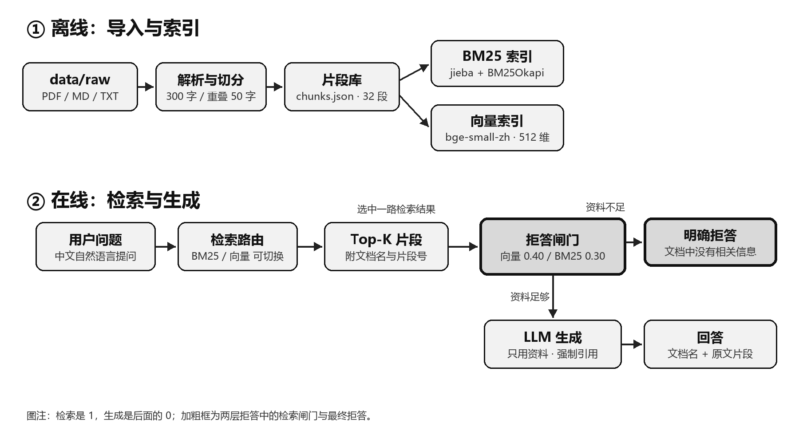

# 不瞎编的私有知识库问答助手

一个最小可用的个人知识库 RAG 应用：只依据你自己的文档回答，答案标注文档名与原文片段；资料不足时明确拒答，而不是硬编。支持在运行时切换 **BM25 关键词检索** 与 **bge-small-zh 向量检索**。



## 已实现的功能

| 作业要求 | 实现位置 |
| --- | --- |
| 导入自己的语料，至少两种格式 | `data/raw/`：2 个 Markdown + 1 个 TXT；`app/corpus.py` 同时支持 PDF |
| 文档切分 | 300 字一段、50 字重叠，按段落/句子优先切 |
| 两种检索可运行时切换 | `app/retrievers.py`，CLI 与 Web 均可切换 |
| 生成答案并标注出处 | 提示词强制 `[编号]`，程序还原为“文档名 + 片段号 + 原文片段” |
| “我不知道”机制 | 检索阈值闸门 + 提示词拒答指令 + 拒答文本识别 |
| 可交互界面 | Gradio Web；另有 CLI |
| 两种检索各跑 20 题 | `eval/questions.jsonl`；`eval/results/results_*.csv` |
| 四项指标 | `scripts/score.py`；`eval/results/metrics.md` |
| 3–5 分钟演示 | `docs/演示录屏.mp4`，脚本见 `docs/演示录屏脚本.md` |

## 快速开始

要求 Python 3.10+。本项目实测：Python 3.13.9、gradio 6.30.0、fastembed 0.9.0、openai 3.35.1、numpy 2.5.4、rank-bm25 0.2.2、jieba 0.42.1。

```bash
python -m venv .venv

# Windows
.venv\Scripts\activate

# macOS / Linux
source .venv/bin/activate

pip install -r requirements.txt
# 运行测试：pip install -r requirements-dev.txt
# 重新导出报告：pip install -r requirements-report.txt
```

复制配置并填写模型接口：

```bash
copy .env.example .env   # Windows
cp .env.example .env     # macOS / Linux
```

最小配置：

```dotenv
LLM_BASE_URL=https://api.deepseek.com/v1
LLM_API_KEY=sk-你的key
LLM_MODEL=deepseek-chat
```

也可以使用本地 Ollama（`http://localhost:11434/v1`、`qwen2.5:3b`）。Pollinations 测试接口见 `.env.example` 的注释块：`LLM_API_KEY` 填 `not-needed` 即可，每 30 秒限 1 次；代码也允许 Pollinations 使用空 key。

建立索引：

```bash
python -m app.cli ingest
```

首次会下载约 95MB 的 bge-small-zh ONNX 模型。国内网络保留 `.env` 中的 `HF_ENDPOINT=https://hf-mirror.com`。如果已有离线模型目录，可设置 `EMBEDDING_MODEL_PATH`，避免再次下载。

提问：

```bash
python -m app.cli ask "BM25 的 k1 和 b 分别控制什么？" --mode bm25
python -m app.cli ask "课程建议的切分长度和作者实验结论一致吗？" --mode vector
```

启动 Web：

```bash
python -m app.ui
```

打开 `http://127.0.0.1:7860`，可切换检索方式、调整 Top-K、勾选“显示检索详情”查看分数与命中文档。

## 语料

`data/raw/` 中共 3 个文档、约 5 700 字：

- `大模型前沿课程笔记.md`：五讲课程笔记，含幻觉分类、RAG 架构、BM25、向量检索、评测指标；
- `RAG实验日记.md`：切分实验、两种检索对比、幻觉拒答踩坑、引用校验；
- `Python环境配置备忘.txt`：venv、国内镜像、VC++ 报错、依赖管理。

详细说明见 [`data/README.md`](data/README.md)。替换语料后必须重新 `ingest`，并按新语料重新校准 `.env` 里的两个拒答阈值。

## 设计要点

### 切分

先按空行切段；超长段落按句号/问号/感叹号/分号切句；再按 300 字打包，相邻片段保留 50 字重叠。作者在 `RAG实验日记.md` 里用 8 道题比较了 200/300/500 字切分，300 字 Top-3 命中 7/8，因此最终选 300 字。

### 两套检索

- **BM25**：jieba 搜索模式分词 + `rank-bm25` 的 BM25Okapi。对专有名词、版本号、原文措辞更敏感，缺点是不懂同义词。
- **向量检索**：`BAAI/bge-small-zh-v1.5`（fastembed，CPU），512 维归一化向量 + 余弦相似度。对口语化、概念性提问更稳，缺点是对数字、编号、拼写不敏感。

两个检索器实现同一个 `search(query, top_k)` 接口，切换只改一个参数。

### 拒答（两层）

1. **检索闸门**：向量 Top-1 余弦相似度低于 `VECTOR_MIN_SCORE`（默认 0.40）直接拒答；BM25 查询实词覆盖率低于 `BM25_MIN_COVERAGE`（默认 0.30）直接拒答。这一层不调用大模型，延迟低，只挡明显域外问题。
2. **生成约束**：提示词要求资料不足时只输出 `INSUFFICIENT_CONTEXT`，程序再识别中英文拒答措辞。这一层负责挡住“词面相关但实际答不了”的陷阱题。

阈值是在当前语料上实测校准的，相关题与陷阱题的分数有重叠，所以不能把检索闸门当成万能判别器；换语料后必须重测。

### 引用

提示词把 Top-K 片段编号后交给模型，要求关键结论后标 `[n]`。程序先解析编号，再按句计算答案与候选片段的 token 重叠：编号虽在范围内但句子不被该片段支撑时，会重映射到最支持的候选；没有候选能支撑则删除该编号。最终只展示通过校验的引用，并还原文档名、片段号和原文。`eval/results` 中对 q02/q04/q15 的原始错引已按此规则修复，引用文档准确率为 100%（15/15）。

## 评测

评测集：`eval/questions.jsonl`，20 题 = 10 道文档题 + 5 道陷阱题 + 5 道多跳题。每题含题型、标准答案、应命中的文档、原文证据句。格式说明见 [`eval/README.md`](eval/README.md)。

```bash
# 只验证检索，不调用大模型
python scripts/evaluate.py --retrieval-only --mode both

# 两种检索各跑 20 题（Pollinations 免费接口建议 --sleep 32）
python scripts/evaluate.py --mode both --sleep 32

# 在 results_*.csv 的 correct 列填 1/0 后计算指标
python scripts/score.py eval/results/results_bm25.csv eval/results/results_vector.csv
```

指标定义：

| 指标 | 定义 |
| --- | --- |
| 答案正确率 | 人工判定答对题数 / 已判定题数；陷阱题正确拒答也算对 |
| 幻觉率 | 陷阱题中未拒答、硬编答案的比例 |
| 检索命中率 | Top-3 中含正确答案 evidence 的题数 / 非陷阱题数 |
| 首 token 延迟 | 从请求开始到第一个内容块的时间 |
| 端到端延迟 | 完整回答生成时间，包含检索和生成 |
| 引用文档准确率 | 引用片段均来自 `source_docs` 的题数 / 有引用题数 |

最终结果：

| 指标 | BM25 | 向量检索 |
| --- | ---: | ---: |
| 答案正确率 | 100%（20/20） | 95%（19/20） |
| 幻觉率（5 陷阱） | 0% | 0% |
| Top-3 检索命中率 | 86.7%（13/15） | 93.3%（14/15） |
| 首次回答平均延迟 | 13.36 s | 10.96 s |
| 端到端平均延迟 | 14.23 s | 12.04 s |
| 引用文档准确率 | 100% | 100% |

逐题结果见 [`eval/results/metrics.md`](eval/results/metrics.md)，完整分析见 [`docs/实验报告_4页.pdf`](docs/实验报告_4页.pdf)。

## 测试

```bash
pytest -q
```

25 个单元测试覆盖切分、PDF 读取、BM25、向量排序、覆盖率、引用核验、拒答判定与格式化，不下载模型、不调用外部 API。

## 项目结构

```text
app/
  config.py       环境变量与路径
  corpus.py       PDF/Markdown/TXT 解析、切分、索引持久化
  retrievers.py   BM25 与向量检索
  rag.py          提示词、拒答闸门、生成、引用还原
  cli.py          ingest / ask / info
  ui.py           Gradio 界面
scripts/
  evaluate.py     批量评测
  score.py        计算四项指标
  build_report_pdf_rl.py  报告导出
data/
  raw/            原创语料
  index/          自动生成的切分与向量索引（gitignore）
eval/
  questions.jsonl 20 题评测集
  results/        逐题 CSV/JSON 与 metrics.md
docs/
  architecture.png
  实验报告.md / 实验报告_4页.pdf
  AI错误清单.md
  演示录屏脚本.md / 演示录屏.mp4
tests/
```

## 已知限制

- **跨语言检索弱**：bge-small-zh 主要面向中文，中文问题检索英文 PDF 时容易失败。
- **切分可能截断句子**：当前重叠按字符而不是按句，部分片段开头会出现半句（如 `rShell`、`们能治`）；本轮未重切，以免改变已固化的 20 题结果。
- **bge 查询前缀未默认启用**：语料日记记录了加前缀 7/8、不加 6/8；代码保留可配置入口，但本轮评测使用的是无前缀配置，重跑会产生另一组数字。
- **生成模型不稳定**：免费接口有速率限制，回答偶发格式不符合 `[n]`；程序按句核验引用，无法支撑的编号会被重映射或删除。
- **评测是 in-sample 且单轮**：0.40/0.30 在最终 20 题上校准，指标偏乐观；5 道陷阱题中仅 q18 由检索闸门直接拒答，其余由生成层拒答。
- **阈值不可迁移**：0.40/0.30 只对当前 27 个片段校准过；换语料后相关与无关分数会整体漂移。
- **延迟受免费接口影响**：首 token 与端到端时间都已记录，但 Pollinations 免费接口排队波动较大，绝对值只代表本机当天网络。

## 常见问题

**首次 ingest 卡在下载模型**：设置 `HF_ENDPOINT=https://hf-mirror.com`，或把已下载的 ONNX 目录写到 `EMBEDDING_MODEL_PATH`。也可以先 `python -m app.cli ingest --no-vector` 只建关键词索引。

**调用返回 401**：检查 `.env` 中的 `LLM_BASE_URL`、`LLM_API_KEY`、`LLM_MODEL` 是否匹配；改完重启进程。

**调用返回 402/429**：免费接口限流。等待 30 秒，评测时加 `--sleep 32`；`_call_llm` 也会按接口提示自动重试。

**向量检索总是拒答**：先用“显示检索详情”看 Top-1 分数，再决定是否下调 `VECTOR_MIN_SCORE`；不要为了过题把阈值降到 0。

**端口被占用**：`python -m app.ui --port 7861`。
