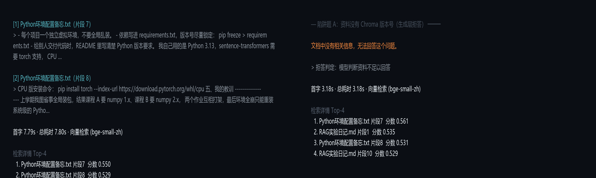

# 不瞎编的私有知识库问答助手

> 姓名：温定浩　学号：2245014148　日期：2026-10-19
>
> **摘要**：本实验实现了一个最小可用的个人知识库 RAG 问答助手，支持 PDF、Markdown、TXT 导入，采用 300 字切分，并可在运行时切换 BM25 与 bge-small-zh 向量检索。系统在生成阶段强制标注原文出处，并通过检索阈值与生成约束两层机制实现拒答。实验使用 20 道自建题（10 道文档题、5 道陷阱题、5 道多跳题）对两种检索各运行一遍，从答案正确率、幻觉率、Top-3 检索命中率和首 token 延迟四个维度进行比较，并定位了一个“检索证据齐全却仍答错”的多跳案例。
>
> **关键词**：检索增强生成；BM25；向量检索；拒答；引用溯源；评测

## 1 系统架构

系统分为四层。**语料层**把 PDF、Markdown、TXT 解析为统一文本，按段落或句子优先切成 300 字片段，相邻片段保留约 50 字的整句重叠。**索引层**为同一批片段分别建立 BM25 倒排统计和 512 维归一化向量索引，向量由本地 bge-small-zh-v1.5（fastembed，CPU）生成。**检索层**用统一的 `search(query, top_k)` 接口封装两个检索器，Web 与 CLI 只改一个参数即可切换。**生成层**把 Top-K 片段编号后拼进提示词，要求每个关键结论标注 `[n]`；程序只接受落在候选范围内的编号，再把编号还原成“文档名 + 片段号 + 原文片段”。

拒答有两道闸门：检索层用向量 Top-1 相似度（< 0.40）或 BM25 查询词覆盖率（< 0.30）挡住明显域外问题；生成层要求模型在资料不足时只输出 `INSUFFICIENT_CONTEXT`，程序同时识别中英文拒答措辞。第一层不调用模型、延迟低，第二层负责“词面相关但实际答不了”的陷阱。

图 1　系统架构：从语料导入、双索引检索到带引用的生成与两层拒答

## 2 实验设置

表 1　实验设置

| 项目 | 设置 |
| --- | --- |
| 语料 | 3 个文档、5 781 字符、2 种格式；最长一篇纯汉字 1 530、按“汉字+英文/数字串”计 1 635，均超过 1 500，口径见 `data/README.md` |
| 切分 | 300 字 / 约 50 字整句重叠（0–100）；3 个文档共 32 个片段；依据是日记中 8 题切分实验：200/300/500 字 Top-3 命中分别为 5/8、7/8、6/8 |
| 关键词检索 | jieba 搜索模式分词 + rank-bm25 BM25Okapi，Top-4 |
| 向量检索 | BAAI/bge-small-zh-v1.5，512 维，余弦相似度，Top-4 |
| 生成 | OpenAI 兼容接口（测试用 Pollinations `openai-fast`），temperature=0，流式输出；提示词禁止使用资料外知识、强制引用 |
| 拒答阈值 | 向量 Top-1 < 0.40；BM25 查询词覆盖率 < 0.30；阈值在这 20 题上校准（in-sample，限制见 3.1） |
| 评测集 | 20 题：10 文档题、5 陷阱题、5 多跳题；每题标注标准答案、来源文档、原文 evidence |
| 环境 | Windows 11，i5-12400 / 16 GB / 无显卡；Python 3.13.9、gradio 6.30.0、fastembed 0.9.0 |

## 3 评测结果

### 3.1 四项指标

表 2　两种检索方案的四项指标

| 指标 | BM25 | 向量检索 |
| --- | ---: | ---: |
| 答案正确率 | 90%（18/20） | 90%（18/20） |
| 幻觉率（5 道陷阱题） | 20%（1/5） | 0%（0/5） |
| Top-3 检索命中率 | 86.7%（13/15） | 86.7%（13/15） |
| 首次回答平均延迟（首 token） | 9.76 s | 8.77 s |
| 端到端平均延迟（参考） | 10.42 s | 9.14 s |
| 引用给出率 | 93.3%（14/15） | 100%（14/14） |
| 引用文档准确率 | 100% | 100% |

BM25 和向量检索各答对 18/20。BM25 的两个错误是 q11（比较题）和 q17（把作业截止日 10 月 21 日说成期末考试日期，属于幻觉）；向量的两个错误是 q11（同一个比较题）和 q15（证据在 Top-4 中，却误输出 `INSUFFICIENT_CONTEXT`）。因此 BM25 的陷阱题正确率只有 80%，幻觉率 20%；向量陷阱题 100% 正确、幻觉率 0%。两者的 Top-3 命中率相同（86.7%），但答案正确率也相同，说明本轮的检索命中与生成正确性没有拉开差距，不能支持“某一种检索更准”的强结论。

延迟上 BM25 首 token 9.76 s、端到端 10.42 s，向量为 8.77 s / 9.14 s。评测脚本没有把检索与生成分项计时，因此不能把差异直接归因于检索；免费接口排队是主要嫌疑，且均值受个别 20 s 级离群值影响，TTFT 中位数为 8.15 s（BM25）/ 9.54 s（向量），排序与均值相反，说明延迟差异不稳健。

引用核验：生成时按句计算答案与候选片段的 token 重叠，q02 等早期出现的“编号在范围内但不支撑句子”会被重映射或删除。最终 15 道有答案题中，BM25 14 道有引用、向量 14/14 有引用；引用片段全部来自 `source_docs`，文档准确率 100%。q02 BM25 的回答没有生成引用，因此引用给出率是 93.3%，没有拿 Top-3 资料冒充引用。

**限制**：阈值最初是在这 20 题上选择的（in-sample）；5 道陷阱题中只有 q18 被检索闸门直接拒答，q16/q17/q19/q20 都由生成层拒答；20 题单轮、2 题差异和 5 题容量都太小，95% 置信区间很宽。因此 90%/90%、20%/0% 只代表本轮观测，不作为泛化结论。另用独立的 `eval/calibration.jsonl`（5 个可答题 + 5 个拒答题）复核：BM25 coverage 可答题 0.60–1.00、拒答题 0–0.50，分离较好；向量相似度可答题 0.515–0.681、拒答题 0.306–0.571，两组重叠，所以向量阈值 0.40 只能做明显域外问题的粗筛。

### 3.2 分题型结果

表 3　分题型结果

| 题型 | 题数 | BM25 正确率 | 向量正确率 | BM25 首 token | 向量首 token |
| --- | ---: | ---: | ---: | ---: | ---: |
| 文档题 | 10 | 100% | 100% | 9.08 s | 9.22 s |
| 多跳题 | 5 | 80% | 60% | 9.48 s | 9.72 s |
| 陷阱题 | 5 | 80% | 100% | 11.40 s | 6.90 s |

检索层面共有 4 处 Top-3 未命中：BM25 的 q11（课程笔记片段 4 排第 4）和 q13，向量的 q12 和 q15。BM25 的 q13、向量的 q12 因为 Top-4 仍包含证据而答对；BM25 的 q11 靠 Top-4 补出“200~400”，但比较结论仍错；向量的 q11 证据齐全却同样答错；向量的 q15 则是在证据未进 Top-3 的情况下直接误拒答。这说明 Top-3 命中、Top-4 上下文和生成推理是三个不同层次，不能只看一个指标。

### 3.3 录屏截图

图 2　录屏截图：左为 q14 向量检索的引用，右为 q19 的生成层拒答（取自 `docs/演示录屏.mp4`，0:45 / 1:52）

左图展示答案末尾的 `[1]` 与 `Python环境配置备忘.txt` 片段 7 的原文；右图展示语料没有 Chroma 版本号时，模型输出“文档中没有相关信息”，并标注“模型判断资料不足以回答”。两图分别对应“引用可核验”和“不知道就说不知道”两个核心行为。

## 4 两问分析

### 4.1 两种检索各自在什么类型的问题上表现更好，为什么？

BM25 在**专有名词、数字、命令和原文措辞明确**的文档题上更稳。q04 的 `k1`、q07 的“1.8 秒 / 4 秒”、q10 的 `Set-ExecutionPolicy` 都是低频精确串，BM25 Top-1 分数分别达到 6.22、18.48、38.43，且第一位就是正确片段；向量检索在 q04 的 Top-1 反而是日记片段 2（0.605），答案只能靠第 2 个候选补出。BM25 的弱点在词面依赖和分片边界：q11 的课程建议落在笔记片段 4（第 4 位），q13 的向量弱点和命中率也分散在 Top-4；q17 则暴露了更危险的一面——只要“日期/作业”等词面相邻，模型就可能把“10 月 21 日截止”当成“期末考试日期”，说明词面命中不等于语义约束。

向量检索在**语义改写、概念性提问和跨文档多跳**上更好：q11 的 Top-3 同时召回日记片段 3（0.809）、片段 2（0.757）和课程片段 4（0.713），q13 同时召回笔记片段 6/7 与日记片段 4。但两者 Top-3 命中率最终都是 86.7%，答案正确率也都是 90%，没有出现“向量明显更准”。向量在 q15 上还暴露了反向问题：正确证据没有进 Top-3，模型直接输出 `INSUFFICIENT_CONTEXT`，属于过度拒答；q11 虽然证据齐全，却仍把“三者命中率不同”误当成“课程建议与实验结论不一致”。总体看，**精确事实优先 BM25，口语化/跨片段优先向量**；但检索分数只能保证“材料相关”，不能保证“模型会正确使用材料”，两者都需要来源感知、比较推理和实体约束。

### 4.2 系统最失败的一个案例是什么，根本原因是什么？

最失败的案例是 q17：“这门课的期末考试安排在几月几日？”BM25 的 Top-3 是课程笔记片段 11（7.248）、片段 12（5.181）、片段 0（1.513）；片段 11 只写了“作业 1 于 10 月 21 日截止”，并没有期末考试日期。BM25 的查询词覆盖率 0.333 通过了 0.30 闸门，模型直接回答“10 月 21 日”，没有给出引用。向量检索这一题正确拒答。标准答案是“文档中没有相关信息”。这是比 q11 更严重的失败：q11 是推理比较错，q17 是系统在“不瞎编”这个核心目标上硬编了一个日期，且把作业截止日偷换成了考试日。

根因有三层。第一层是**近域陷阱**：考试日期与作业截止日共享“课程/日期/10 月”等词，BM25 覆盖率闸门看到部分词就放行；q17 不是完全域外问题，检索层挡不住。第二层是**实体与关系约束缺失**：提示词要求“只依据资料”，但没有要求模型先核对“问题问的事件/实体”是否在资料中明确出现；模型把“作业截止”这个相邻事实迁移成“期末考试”。第三层是**引用约束没有形成硬失败**：回答没有引用，界面虽显示“未经出处验证”，但仍把日期作为答案展示，没有触发拒答或重试。修正方向是：对日期/人名/型号等槽位做实体匹配，问题中的事件和资料中的事件不完全对应时直接拒答；无引用的回答必须降级为“不可核验”并重试/拒答；同时增加 gate-only / prompt-only / both 的消融和更多近域陷阱，才能证明两层拒答各自的贡献。q11 仍未解决：两套检索都把“课程建议 200~400 包含实验最优 300”误判成“不一致”，说明比较题的查询分解和比较模板还需要单独实现。

## 5 AI 错误清单

表 4　AI 生成代码的主要错误与修正

| # | AI 给了什么 | 错在哪 | 怎么发现 | 怎么修正 |
| --- | --- | --- | --- | --- |
| 1 | `gr.Chatbot(type="messages", show_copy_button=True)` | Gradio 5 旧参数，本机 Gradio 6.30 已移除 | 构造界面报 `TypeError: unexpected keyword argument 'type'` | 查 `inspect.signature`，改成 `buttons=["copy"]` |
| 2 | 断言 `query_coverage("莫干山 雪山") == 0.5` | 忽略 jieba 搜索模式会把“莫干山”再切成子词，实际 0.667 | `pytest` 断言失败，打印 0.666… | 改成“部分命中，0 < coverage < 1”，补完全无关为 0 的断言 |
| 3 | 初版向量阈值拍脑袋设 0.35，并声称相关 >0.52、无关 <0.30 | 阈值没有实测；校准后无关问题 0.509，相关问题下限 0.441，两组重叠 | 8 个相关 + 8 个无关问题逐条打印 Top-1 分数 | 阈值改 0.40，只做粗筛；语义陷阱交给生成阶段 |
| 4 | 引用正则只写 `\[(\d+)\]` | 模型实际输出中文括号 `【1】`，citations 为空 | pilot 回答有 `【1】`，CSV 的 citations 列却为空 | 正则同时匹配 `[] 【】 ［］ 〔〕`，补单测 |
| 5 | 直接用 fastembed 默认临时缓存目录下载模型 | 沙箱或临时目录权限导致下载反复失败，索引建不起来 | `ingest` 报 `PermissionError` 或 `Could not load model` | 支持 `EMBEDDING_MODEL_PATH` 离线模型目录，缓存改到工作区 `.cache/` |
| 6 | 流式响应直接取 `chunk.choices[0].delta.content` | 兼容接口会先返回 `choices=[]` 的 usage/心跳块，触发 `IndexError` | 流式冒烟测试抛 `IndexError: list index out of range` | 跳过空 `choices`，只拼接非空 delta，并用首个内容块记录首 token |

## 6 总结

**怎么利用 AI 重构代码。** 我先让 AI 生成最小骨架（解析、切分、BM25、向量、CLI、评测脚本），再用测试和真实运行逐段否决：Gradio 6 的参数、jieba 的分词行为、引用括号、临时目录权限，都是跑起来才暴露的。AI 适合写“可验证的局部”，不适合替我做“阈值是否可信、题是否真的有答案、引用是否指向正确片段”这类判断。每次修改后我都用 `pytest`、`--retrieval-only` 或单题 CLI 复现，确认不是“看起来对”。

**评测陷阱。** 第一，文档级命中会高估检索：q13 的 Top-3 没有向量弱点片段，但同文档另一片段在 Top-4，答案仍然对，若只按文档名判分会看不出缺口。第二，Top-3 与 Top-K 不是一回事：本系统实际给模型 Top-4，所以“Top-3 命中率”低不代表答错，报告必须同时看上下文和答案。第三，陷阱题要先确认语料真的没有答案；“Chroma 版本号”这种题看似可答，实际只提到 chroma、没有版本。第四，q11 暴露了“一致吗”这种比较题容易被模型用字面数字糊弄，出题时应把判定规则写进标准答案。第五，免费接口有 30 秒限流，评测必须限速并记录重试，否则 402 会被误记成模型错误。

**AI 时代什么能力最重要。** 不是把代码写出来，而是定义可验证的目标、设计能暴露问题的评测，并对“自信的输出”保持怀疑。代码可以生成，检索片段不会说谎；真正稀缺的是判断哪条证据算数、哪个指标被高估、哪个 failure 是检索、切分还是生成的锅。这次实验最大的收获，是把“不瞎编”从一句提示词，变成了阈值、引用校验、20 题评测和一份能复现的失败记录。
