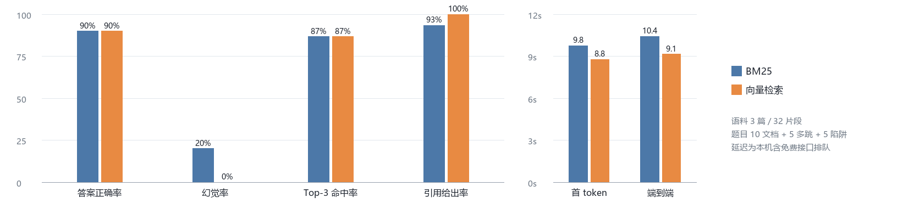
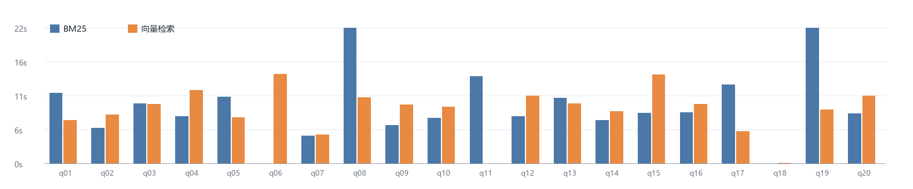

# 不瞎编的私有知识库问答助手

> 姓名：温定浩　学号：2245014148　日期：2026-10-20
>
> **摘要**：本实验实现了一个最小可用的个人知识库 RAG 问答助手，支持 PDF、Markdown、TXT 导入，采用 300 字切分，可在运行时切换 BM25 与 bge-small-zh 向量检索。生成阶段强制标注原文出处，并用“检索阈值 + 提示词约束”两层机制实现拒答。用自建 20 题（10 文档题、5 多跳题、5 陷阱题）对两种检索各跑一遍，从答案正确率、幻觉率、Top-3 命中率和首 token 延迟四个维度比较，定位了“证据齐全仍答错”和“近域陷阱被硬编”两类失败。
>
> **关键词**：检索增强生成；BM25；向量检索；拒答；引用溯源；评测

## 1 系统架构

系统分四层。**语料层**把 PDF、Markdown、TXT 解析为统一文本，按段落/句子切分并在相邻片段间保留整句重叠。**索引层**为同一批片段分别建立 BM25 倒排统计与 512 维归一化向量索引，向量由本地 bge-small-zh-v1.5（fastembed，CPU）生成。**检索层**用统一的 `search(query, top_k)` 接口封装两个检索器，CLI 与 Web 只改一个参数即可切换。**生成层**把 Top-4 片段编号后拼进提示词，要求关键结论标注 `[n]`；程序只接受落在候选范围内的编号，再按句核验该片段是否真的支撑这句话，最后还原为“文档名 + 片段号 + 原文”。

拒答有两道闸门：检索层用向量 Top-1 相似度（< 0.40）或 BM25 查询词覆盖率（< 0.30）挡住明显域外问题；生成层要求模型在资料不足时只输出 `INSUFFICIENT_CONTEXT`，程序同时识别中英文拒答措辞。第一层不调用模型、延迟低，第二层负责“词面相关但实际答不了”的陷阱。

图 1　系统架构：语料导入、双索引检索、带引用校验的生成与两层拒答

## 2 实验设置

表 1　实验设置

| 项目 | 设置 |
| --- | --- |
| 语料 | 3 个文档、5 781 字符、2 种格式；最长一篇纯汉字 1 530，口径见 `data/README.md` |
| 切分 | 300 字 / 约 50 字整句重叠；3 个文档共 32 个片段；依据日记中 8 题实验：200/300/500 字 Top-3 命中 5/8、7/8、6/8 |
| 关键词检索 | jieba 搜索模式分词 + rank-bm25 BM25Okapi，Top-4 |
| 向量检索 | BAAI/bge-small-zh-v1.5，512 维，余弦相似度，Top-4 |
| 生成 | OpenAI 兼容接口（测试用 Pollinations `openai-fast`），temperature=0，流式输出 |
| 拒答阈值 | 向量 Top-1 < 0.40；BM25 覆盖率 < 0.30；在这 20 题上校准（in-sample，限制见 3.1） |
| 评测集 | 20 题：10 文档题、5 多跳题、5 陷阱题；每题标注标准答案、来源文档、原文 evidence |
| 环境 | Windows 11，i5-12400 / 16 GB / 无显卡；Python 3.13.9、gradio 6.30.0、fastembed 0.9.0 |

## 3 评测结果

### 3.1 四项指标

表 2　两种检索方案的四项指标

| 指标 | BM25 | 向量检索 |
| --- | ---: | ---: |
| 答案正确率 | 90%（18/20） | 90%（18/20） |
| 幻觉率（5 道陷阱题） | 20%（1/5） | 0%（0/5） |
| Top-3 检索命中率 | 86.7%（13/15） | 86.7%（13/15） |
| 首次回答平均延迟（首 token） | 9.76 s | 8.77 s |
| 端到端平均延迟（参考） | 10.42 s | 9.14 s |
| 引用给出率 | 93.3%（14/15） | 100%（14/14） |
| 引用文档准确率 | 100% | 100% |

图 2　四项指标与延迟对比：正确率、命中率完全打平，差异只在幻觉率与延迟

两者都答对 18/20，但错在不同的题：BM25 错 q11（比较题）和 q17（把作业截止日 10 月 21 日说成期末考试日期，属幻觉），向量错 q11 和 q15（证据在 Top-4 中却误输出 `INSUFFICIENT_CONTEXT`，属过度拒答）。因此 BM25 幻觉率 20%、向量 0%。**限制**：阈值是在这 20 题上选的（in-sample），5 道陷阱题中只有 q18 被检索闸门直接拒答，其余由生成层拒答；20 题单轮、样本小，90%/90% 只代表本轮观测。另用独立的 `eval/calibration.jsonl`（5 可答 + 5 应拒答）复核：BM25 覆盖率两组分离较好（0.60–1.00 对 0–0.50），向量相似度两组重叠（0.515–0.681 对 0.306–0.571），所以 0.40 只能做粗筛。

### 3.2 分题型结果与延迟

表 3　分题型结果

| 题型 | 题数 | BM25 正确率 | 向量正确率 | BM25 首 token | 向量首 token |
| --- | ---: | ---: | ---: | ---: | ---: |
| 文档题 | 10 | 100% | 100% | 9.08 s | 9.22 s |
| 多跳题 | 5 | 80% | 60% | 9.48 s | 9.72 s |
| 陷阱题 | 5 | 80% | 100% | 11.40 s | 6.90 s |

图 3　20 题逐题首 token 延迟：q18 几乎为 0（检索闸门直接拒答），q08/q19 出现 20 s 级离群值

检索层面 4 处 Top-3 未命中：BM25 的 q11、q13，向量的 q12、q15。q13、q12 因 Top-4 仍含证据而答对；q11 靠 Top-4 补出“200~400”但结论仍错；q15 在证据未进 Top-3 时误拒答。可见 Top-3 命中、Top-4 上下文与生成推理是三个层次。延迟上 q18 是唯一的闸门拒答（0.003 s），其余波动主要来自免费接口排队，不能直接归因于检索。

### 3.3 实际运行与界面

CLI 与 Web 共用同一个 `answer_question`，下面的终端输出即界面行为：左为答对并给出处，右为陷阱题被闸门当场拒绝，均取自 2026-10-20 的真实运行（日志见 `docs/demo_run.log`）。

图 4　真实运行：左为 q14 向量检索的答案与首条引用，右为 q18 的检索闸门拒答（0.286 < 0.40）

图 5　Gradio 界面：检索方式可运行时切换、Top-K 可调、可勾选显示检索详情与分数

表 4　四个示例问答（均取自 2026-10-20 的真实运行，日志见 `docs/demo_run.log`）

| 问题 | 结果 | 出处 |
| --- | --- | --- |
| q14 为什么强调每个项目建独立虚拟环境？上学期遇到什么版本冲突？ | 答对：避免全局装包冲突；课程 A 要 numpy 1.x、课程 B 要 numpy 2.x，最后只能重装 | `Python环境配置备忘.txt` 片段 7、8 |
| q10 PowerShell 禁止运行脚本时该执行什么命令？ | 答对：`Set-ExecutionPolicy -ExecutionPolicy RemoteSigned -Scope CurrentUser` | `Python环境配置备忘.txt` 片段 2 |
| q19 安装的 Chroma 版本号是多少？ | 拒答：语料只提到 chroma，没有版本号 | — |
| q18 在莫干山徒步时住的是哪家民宿？ | 拒答：Top-1 相似度 0.286 < 0.40，检索层 0 秒拒绝 | — |

### 3.4 工程可复现性

从零到可查只需要四条命令，下图是 2026-10-20 在本机（Windows 11 / Python 3.13.9）逐条执行的原始输出，未做任何拼接或改写。

图 6　四条命令的真实输出：建索引得到 3 文档 32 片段、33 项单测全部通过、四项指标由 CSV 复算得出（与表 2 一致）

## 4 两问分析
### 4.1 两种检索各自在什么类型的问题上表现更好，为什么？

BM25 在**专有名词、数字、命令和原文措辞明确**的题上更稳。q04 的 `k1`、q07 的“1.8 秒 / 4 秒”、q10 的 `Set-ExecutionPolicy` 都是低频精确串，BM25 Top-1 分数分别为 6.22、18.48、38.43 且第一位就是正确片段；向量在 q04 的 Top-1 反而是日记片段 2（0.605），答案只能靠第 2 个候选补出。BM25 的弱点在词面依赖：q11 的课程建议落在笔记片段 4（第 4 位），q13 的命中分散在 Top-4；q17 更危险——只要“日期/作业”词面相邻，模型就可能把“10 月 21 日截止”当成“期末考试日期”，说明词面命中不等于语义约束。

向量检索在**语义改写、概念性提问和跨文档多跳**上更好：q11 的 Top-3 同时召回日记片段 3（0.809）、片段 2（0.757）和课程片段 4（0.713），q13 同时召回笔记片段 6/7 与日记片段 4。但两者 Top-3 命中率都是 86.7%、正确率都是 90%，没有出现“向量明显更准”。向量在 q15 上还暴露了反向问题：正确证据没进 Top-3，模型直接输出 `INSUFFICIENT_CONTEXT`，属于过度拒答。总体看，**精确事实优先 BM25，口语化与跨片段优先向量**；但检索分数只保证“材料相关”，不保证“模型会用”。

### 4.2 系统最失败的一个案例是什么，根本原因是什么？

最失败的是 q17：“这门课的期末考试安排在几月几日？”BM25 的 Top-3 是笔记片段 11（7.248）、12（5.181）、0（1.513），片段 11 只写了“作业 1 于 10 月 21 日截止”，没有考试日期。覆盖率 0.333 过了 0.30 闸门，模型直接答“10 月 21 日”且无引用；向量这一题正确拒答。这比 q11 更严重：q11 是推理比较错，q17 是在“不瞎编”这个核心目标上硬编，还把作业截止日偷换成考试日。

根因有三层。**近域陷阱**：考试日期与作业截止日共享“课程/日期/10 月”等词，覆盖率闸门看到部分词就放行，检索层挡不住。**实体与关系约束缺失**：提示词要求“只依据资料”，但没要求模型先核对问题问的事件是否在资料中出现，模型把相邻事实迁移成了答案。**引用约束没有形成硬失败**：回答没有引用，界面虽提示“未经出处验证”，仍把日期当作答案展示。修正方向是：对日期、人名、型号等槽位做实体匹配，问题中的事件与资料中的事件不对应时直接拒答（代码里已实现可选的 `STRICT_SLOT_CHECK`，默认关闭以免改变本报告的实测数字）；无引用的回答必须降级为“不可核验”并重试；再补 gate-only / prompt-only / both 的消融，才能证明两层各自的贡献。q11 仍未解决：两套检索都把“课程建议 200~400 包含实验最优 300”误判为“不一致”，说明比较题需要单独的查询分解与比较模板。

## 5 AI 错误清单

表 5　AI 生成代码的主要错误与修正

| # | AI 给了什么 | 错在哪 | 怎么发现 | 怎么修正 |
| --- | --- | --- | --- | --- |
| 1 | `gr.Chatbot(type="messages", show_copy_button=True)` | Gradio 5 旧参数，本机 Gradio 6.30 已移除 | 构造界面报 `TypeError: unexpected keyword argument 'type'` | 查 `inspect.signature`，改成 `buttons=["copy"]` |
| 2 | 断言 `query_coverage("莫干山 雪山") == 0.5` | 忽略 jieba 搜索模式会再切子词，实际 0.667 | `pytest` 断言失败，打印 0.666… | 改成“部分命中，0 < coverage < 1” |
| 3 | 初版向量阈值拍脑袋设 0.35，声称相关 >0.52、无关 <0.30 | 无实测依据；实测可答 0.515–0.681、应拒答 0.306–0.571，两组重叠 | `python scripts/calibrate.py` 逐条打印 10 条（5 可答 + 5 应拒答）的 Top-1 分数 | 阈值定 0.40，只做粗筛，重叠区交给生成层 |
| 4 | 引用正则只写 `\[(\d+)\]` | 模型实际输出中文括号 `【1】`，citations 为空 | pilot 回答有 `【1】`，CSV 的 citations 列却为空 | 正则同时匹配 `[] 【】 ［］ 〔〕`，补单测 |
| 5 | 直接用 fastembed 默认临时缓存目录 | 沙箱/临时目录权限导致模型反复下载失败 | `ingest` 报 `PermissionError` 或 `Could not load model` | 支持 `EMBEDDING_MODEL_PATH` 离线目录，缓存改到工作区 `.cache/` |
| 6 | 流式响应直接取 `chunk.choices[0].delta.content` | 兼容接口会先返回 `choices=[]` 的心跳块，触发 `IndexError` | 流式冒烟测试抛 `IndexError` | 跳过空 `choices`，只拼接非空 delta，并在首个内容块记录首 token |

## 6 总结

**怎么利用 AI 重构代码。** 先让 AI 生成最小骨架（解析、切分、BM25、向量、CLI、评测脚本），再用测试和真实运行逐段否决：Gradio 6 的参数、jieba 的分词行为、引用括号、临时目录权限，都是跑起来才暴露的。AI 适合写“可验证的局部”，不适合替我做“阈值是否可信、题是否真的有答案、引用是否指向正确片段”这类判断；每次修改后都用 `pytest`、`--retrieval-only` 或单题 CLI 复现，确认不是“看起来对”。

**评测陷阱。** 一是文档级命中会高估检索：q13 的 Top-3 没有向量弱点片段，但同文档另一片段在 Top-4，答案仍然对。二是 Top-3 与 Top-K 不是一回事，本系统实际给模型 Top-4，报告必须同时看上下文和答案。三是陷阱题要先确认语料真的没有答案，“Chroma 版本号”这种题看似可答，实际只提到 chroma、没有版本。四是 q11 暴露了“一致吗”这类比较题容易被字面数字糊弄，出题时应把判定规则写进标准答案。五是免费接口有 30 秒限流，评测必须限速并记录重试，否则 402 会被误记成模型错误。

**AI 时代什么能力最重要。** 不是把代码写出来，而是定义可验证的目标、设计能暴露问题的评测，并对“自信的输出”保持怀疑。代码可以生成，检索片段不会说谎；真正稀缺的是判断哪条证据算数、哪个指标被高估、哪个 failure 是检索、切分还是生成的锅。这次实验最大的收获，是把“不瞎编”从一句提示词，变成了阈值、引用校验、20 题评测和一份能复现的失败记录。
